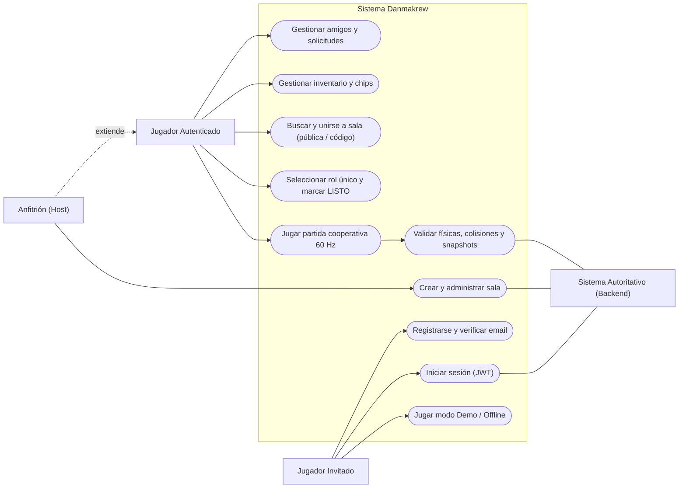

# Proyecto Integrador — Danmakrew

Repositorio unificado de **NoMercyGames** para **Danmakrew**: *Bullet Hell* cooperativo multijugador 100% web, diseñado para ofrecer alta dificultad, progresión por farmeo y juego social en tiempo real con un consumo mínimo de recursos.

---

## H1 · Kickoff — Mercado, Problema y Alcance

### A1 · Problema Real del Mercado Identificado

#### Sector de mercado objetivo
Entusiastas de PC gaming de nicho *hardcore* y fanáticos del género **Bullet Hell / Danmaku** que buscan experiencias de alta exigencia mecánica, cooperación táctica y sistemas profundos de progresión y farmeo, pero que suelen jugar en solitario por la falta de espacios sociales accesibles dentro del género.

#### Problemática detectada
1. **Aislamiento en un género históricamente individual**: La mayoría de los títulos *bullet hell* están enfocados en el modo *single-player* o cooperativo local, dificultando que jugadores afines se encuentren, formen escuadrones y compartan la experiencia en línea.
2. **Barrera de hardware y fricción de entrada**: Muchos juegos cooperativos actuales requieren descargas pesadas y equipos de gama media/alta, dejando fuera a usuarios con computadoras modestas o hardware limitado.
3. **Escasez de progresión cooperativa con roles definidos**: Faltan propuestas web ligeras que combinen patrones *danmaku* de alta dificultad con roles tácticos complementarios y un bucle de farmeo/mejora persistente.

#### Propuesta de valor de Danmakrew
- **Multijugador social en navegador**: Creación de salas públicas o privadas por código, lista de amigos y emparejamiento rápido en lobby en tiempo real.
- **Arquitectura ultraligera (apta para hardware modesto)**: Ejecución directa en navegador (y compilable como PWA) con renderizado 2D optimizado en **PixiJS v7** y descarga de cálculo a **Web Workers** para sostener 60 FPS estables sin requerir GPU dedicada ni instalaciones pesadas.
- **Alta dificultad cooperativa**: Simulación autoritativa a 60 Hz, jefes multifase, mecánicas de *Beam Struggle* y roles únicos por escuadrón (`Tank`, `Support`, `DPS`, `Special_Attack`).
- **Potencial de farmeo y progresión**: Sistema persistente de inventario y *chips* con estadísticas para personalizar y potenciar el rendimiento en partida.

---

### A2 · Actores y Diagrama de Casos de Uso

| Actor | Descripción |
|-------|-------------|
| **Jugador Invitado** | Usuario no autenticado que puede registrarse, verificar su correo electrónico, iniciar sesión o probar la arena en modo Demo / Offline (`demo-room-01`). |
| **Jugador Autenticado** | Usuario con sesión JWT activa. Gestiona amigos, inventario de *chips*, se une a salas públicas o por código, selecciona rol único y participa en partidas cooperativas. |
| **Anfitrión (Host)** | Jugador autenticado que crea una sala, define su visibilidad (pública/privada) y coordina el inicio o cierre de la sesión de lobby. |
| **Sistema Autoritativo (Backend)** | Orquesta autenticación/persistencia (SQLite), salas efímeras (Redis), señalización WS (`/signal`) y físicas autoritativas a 60 Hz (`/game`). |



---

### A3 · Backlog de User Stories

| ID | Historia de Usuario | Criterios de Aceptación |
|----|---------------------|-------------------------|
| **US-01** | **Como** jugador invitado, **quiero** registrarme con verificación por correo e iniciar sesión con credenciales seguras, **para** guardar mi progreso, amigos e inventario. | • El registro valida formato de datos con Zod y almacena la contraseña hasheada con `bcryptjs` en SQLite.<br>• Se envía un correo de verificación mediante `nodemailer` antes de habilitar el acceso completo.<br>• El login emite un token JWT válido y bloquea credenciales incorrectas. |
| **US-02** | **Como** jugador solitario de *bullet hell*, **quiero** enviar y aceptar solicitudes de amistad, **para** construir una lista de compañeros con los que jugar frecuentemente. | • Un jugador autenticado puede enviar una solicitud de amistad a otro usuario.<br>• El destinatario puede listar solicitudes pendientes y aceptarlas.<br>• Al aceptarse, ambos usuarios quedan vinculados en la tabla `friend`. |
| **US-03** | **Como** anfitrión, **quiero** crear una sala pública o privada con código de acceso, **para** reunir a mis amigos o abrir partida a la comunidad. | • El endpoint `POST /api/rooms` crea la sala en Redis con TTL de 2 horas y asigna al creador como `hostId`.<br>• Las salas públicas aparecen en el navegador de salas (`GET /api/rooms`).<br>• Las salas privadas permiten el ingreso mediante código único (`GET /api/rooms/by-code/:code`). |
| **US-04** | **Como** jugador en lobby, **quiero** elegir un rol único (`Tank`, `Support`, `DPS` o `Special_Attack`) y marcar **LISTO**, **para** coordinar la estrategia del escuadrón antes de entrar a la arena. | • No se permiten roles duplicados dentro de la misma sala.<br>• Los cambios de rol y estado de preparación se sincronizan en tiempo real vía `/signal`.<br>• Cuando todos los jugadores están listos, la sala pasa a estado `in_game` y emite `game-start`. |
| **US-05** | **Como** jugador en partida, **quiero** combatir contra oleadas y jefes con físicas precisas y baja latencia desde el navegador, **para** disfrutar una experiencia *danmaku* fluida incluso en una PC modesta. | • El servidor simula físicas Planck.js a 60 Hz de forma autoritativa (`/game`).<br>• El cliente interpola snapshots en `snapshot.worker.ts` y renderiza en PixiJS v7 a 60 FPS fuera del hilo principal.<br>• Si no hay conexión al servidor WS, `GameWorkerBridge` activa el modo demo local con `gameSimulation.worker.ts`. |
| **US-06** | **Como** jugador enfocado en el farmeo, **quiero** obtener y gestionar *chips* con estadísticas en mi inventario, **para** mejorar y personalizar mis capacidades en futuras partidas. | • El usuario cuenta con inventario persistente en SQLite (`inventory`, `chip`, `chip_stats`).<br>• Los *chips* pueden consultarse y añadirse al inventario mediante la API autenticada (`POST /api/auth/user/inventory/chips`). |

---

## Arquitectura y Stack Tecnológico (Actualizado)

Tras la evolución del proyecto hacia una arquitectura unificada **Backend autoritativo + Thin Client React/PixiJS**, este es el stack **realmente activo** en el código:

| Capa | Tecnología en Uso | Propósito |
|------|-------------------|-----------|
| **API HTTP** | Fastify v4 + Zod (`8080`) | Endpoints REST, validación de esquemas, CORS (`@fastify/cors`) y rate limiting (`@fastify/rate-limit`) |
| **Autenticación y Persistencia** | SQLite (`better-sqlite3`) + **JWT (`jsonwebtoken`)** + `bcryptjs` + `nodemailer` | Registro, hash de contraseñas, verificación por email y sesiones stateless |
| **Salas efímeras** | Redis Stack (`ioredis`, TTL 2h) | Almacenamiento temporal de salas, jugadores, roles y estado `in_game` |
| **Señalización & Servidor de Juego WS** | `µWebSockets.js` con fallback automático a `ws` (`uwsCompat.js`, puerto `9001`) | Lobby en tiempo real (`/signal`) y streaming autoritativo de partida (`/game`) |
| **Físicas autoritativas** | Planck.js (`60 Hz`) | Simulación rígida de jugadores, proyectiles, muros, enemigos y *Beam Struggle* en servidor y worker de respaldo |
| **Frontend Web + Juego Unificado** | React 19 + React Router v7 + TypeScript + PixiJS v7 + Vite 6 + PWA (`vite-plugin-pwa`) | SPA unificada, renderizado 2D acelerado por WebGL y soporte instalable |
| **Web Workers (Frontend)** | `snapshot.worker.ts` + `gameSimulation.worker.ts` | Interpolación a 60 FPS fuera del hilo principal y simulación local Planck.js para modo offline/demo |

---

## G2 · Estrategia de Branching (Análisis y Estándar)

### Análisis de la estrategia utilizada hasta ahora
Al inspeccionar el historial de commits y ramas remotas del repositorio se observa lo siguiente:
- **Integración por Pull Requests sobre `main`**: La mayoría de los cambios llegaron a `main` mediante Pull Requests (`#20` hasta `#67`), evitando el trabajo directo masivo sobre la rama principal.
- **Trazabilidad por número de Issue**: La convención predominante ha sido `<numero-issue>-<slug>` (por ejemplo, `58-making-of-the-inventory-something-functional-and-predictable`, `66-oauth2`, `68-modify-readmemd`).
- **Desviaciones detectadas**:
  - Ramas ad-hoc fuera de convención (`fix-lobbys`, `fix/sas`) y merges puntuales directos sin PR (`Merge branch '38-sas'`).
  - Nombres de rama poco descriptivos en etapas intermedias (`38-sas`, `41-cooc-reeer-tiooot`, `44-reverse-lego`).
  - Falta de una regla documentada de protección de `main` y de prefijos semánticos uniformes.

### Estándar de Branching adoptado (`main` protegida + `feature/*`)
Para consolidar el flujo de trabajo en equipo se establece la siguiente política:
1. **Rama `main` protegida**: Prohibido hacer `push` directo; toda integración requiere **Pull Request** aprobado y checks en verde (`typecheck:frontend`, `build:frontend`, `test:physics`).
2. **Convención de ramas**:
   - `feature/<issue>-<descripcion-corta>` — Nuevas funcionalidades (ej. `feature/66-oauth2`).
   - `fix/<issue>-<descripcion-corta>` — Corrección de errores (ej. `fix/34-lobby-sync`).
   - `docs/<issue>-<descripcion-corta>` — Cambios de documentación (ej. `docs/68-update-readme`).
3. **Flujo de trabajo**: Crear rama desde `main` actualizada → commits atómicos → abrir PR enlazado al Issue → revisión → *squash/merge* a `main` y eliminación de la rama temporal.

---

## Estructura del Proyecto

```text
Proyecto-Integrador/
├── Backend/
│   ├── scripts/
│   │   └── testPhysics.js          # Suite automatizada de físicas Danmakrew
│   └── src/
│       ├── config/                 # SQLite, JWT Auth, Redis
│       ├── game/                   # Motor autoritativo 60Hz (GameRoom, Planck.js, Boss, Bullets, Walls)
│       ├── middleware/             # Autenticación JWT de sesiones
│       ├── routes/                 # Auth, amigos, inventario, salas (userRoutes.js, roomRoutes.js)
│       ├── utils/                  # Mailer, compatibilidad uWS/ws, utilidades de salas (roomUtils.js)
│       ├── ws/                     # Servidor WS de partida (/game), seguridad y guardas de input
│       ├── signal.js               # Señalización WS de lobby (/signal) y transición a partida
│       └── index.js                # Punto de entrada unificado (Fastify + WS)
├── Frontend/
│   ├── public/assets/              # Sprites, escenarios y efectos de sonido del juego
│   └── src/
│       ├── components/             # Componentes globales de la web (Header, Modals, ProtectedRoute)
│       ├── game/                   # Motor y sesión del juego Danmakrew integrados en la SPA
│       │   ├── components/         # HUD táctico, overlays de arena, controles táctiles y flotantes
│       │   ├── engine/             # Renderizador PixiJS v7, etapas 1-3, balas, jefes y efectos
│       │   ├── network/            # Cliente WebSocket tipado (/game)
│       │   ├── session/            # Orquestación de partida, puente de workers y estado del escuadrón
│       │   └── workers/            # snapshot.worker.ts (interpolación) y gameSimulation.worker.ts (Planck.js)
│       ├── pages/                  # Home, LobbyBrowser, JoinSelection, CharacterSelection, Game (/game), Auth
│       ├── services/               # Clientes REST y WebSocket de lobby (api.js, wsClient.js)
│       └── styles/                 # Hojas de estilo modulares (incluye game.css con prefijo dk-*)
├── postman/                        # Colección de pruebas de API
├── docker-compose.yml              # Orquestación completa (Redis + Backend + Frontend)
└── package.json                    # Scripts raíz del workspace
```

---

## Flujo Lobby → Selección de Personaje → Partida (`/game`)

1. **Salas (`/rooms` / `/create-room`)**: Creación y unión a salas almacenadas en Redis y sincronizadas por `/signal`.
2. **Selección de Personaje (`/character-selection`)**:
   - Cada jugador elige un rol único entre `Tank`, `Support`, `DPS` y `Special_Attack` (sin duplicados en el escuadrón).
   - Cuando todos los jugadores marcan **LISTO**, el servidor marca la sala como `in_game` (preservando la sala en Redis durante el cambio de vista) y emite `game-start`.
3. **Partida (`/game`)**:
   - **Modo Online**: `GameWSClient` recibe snapshots del backend autoritativo (`GameRoom` + Planck.js) y los envía a `snapshot.worker.ts`, que interpola posiciones, proyectiles, muros, enemigos, ítems, jefe y *Beam Struggle* a 60 FPS fuera del hilo principal.
   - **Modo Offline / Demo (`demo-room-01`)**: Si el servidor WS no está disponible o se entra en sala de prueba, `GameWorkerBridge` levanta automáticamente `gameSimulation.worker.ts` con las **mismas físicas Planck.js** (muros de Tank de 25 HP / 1.0s TTL, auto-aim + curación de Support, ráfaga de DPS, Master Spark de 50 DPS de SP.ATK, choque de rayos *Beam Struggle* y jefe de 5 fases) conectado a `snapshot.worker.ts`.

---

## Ejecución con Docker Compose

### 1. Configurar variables de entorno

```bash
cp Backend/.env.example Backend/.env
```

### 2. Levantar todos los servicios

```bash
docker compose up --build
```

| Servicio | Puerto local | Descripción |
|----------|-------------|-------------|
| **redis** | `6379` | Redis Stack (salas efímeras) |
| **api** | `8080` | Backend HTTP REST (Fastify) |
| **api** | `9001` | Señalización `/signal` y servidor de juego `/game` (`µWebSockets.js` / `ws`) |
| **frontend** | `3000` | Aplicación unificada React + PixiJS + Web Workers |

---

## Desarrollo Local (sin Docker)

Requisitos: Node.js 20+ y Redis corriendo en `127.0.0.1:6379` (para salas online; el modo demo funciona incluso sin backend).

```bash
# Instalar dependencias
npm --prefix ./Backend install
npm --prefix ./Frontend install

# Levantar Backend (:8080 / :9001) + Frontend (:3000) juntos en una sola terminal
npm run dev
```

Luego abrí **http://localhost:3000** en el navegador (el puerto `8080` es únicamente la API REST).

### Comandos de verificación desde la raíz

| Comando | Descripción |
|---------|-------------|
| `npm run dev` | Inicia Backend + Frontend en simultáneo desde una sola terminal |
| `npm run dev:backend` | Inicia solo el backend en modo watch (`:8080` + `:9001`) |
| `npm run dev:frontend` | Inicia solo Vite en desarrollo (`http://localhost:3000`) |
| `npm run typecheck:frontend` | Verifica tipos TypeScript (`tsc --noEmit`) del motor, sesión y Web Workers |
| `npm run build:frontend` | Compila el bundle de producción de `Frontend/` (React + PixiJS + Workers + PWA) |
| `npm run test:physics` | Ejecuta la batería de pruebas de físicas Planck.js del backend |
