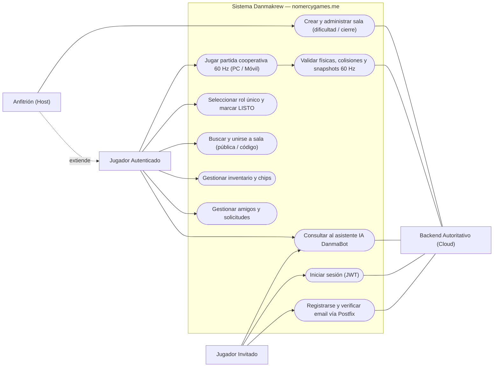

# Proyecto Integrador — Danmakrew (NoMercyGames)

Repositorio unificado de **NoMercyGames** para **Danmakrew**: *Bullet Hell* cooperativo multijugador 100% web desplegado en producción en **[https://nomercygames.me](https://nomercygames.me)**, diseñado para ofrecer alta dificultad, cooperación en tiempo real y progresión por *chips* con consumo mínimo de recursos.

---

## 1. Fundamentación, Mercado y Propuesta de Valor

### Sector de mercado objetivo
Entusiastas del género **Bullet Hell / Danmaku** y jugadores cooperativos que buscan experiencias de alta exigencia mecánica, roles tácticos y juego social accesible sin descargas pesadas ni requisitos elevados de hardware.

### Problemática detectada
1. **Aislamiento en un género históricamente individual**: La mayoría de los títulos *bullet hell* son *single-player* o cooperativo local, dificultando jugar en escuadrón en línea.
2. **Barrera de hardware y fricción de entrada**: Muchos juegos cooperativos exigen descargas grandes y PCs de gama media/alta.
3. **Escasez de progresión cooperativa con roles definidos**: Faltan propuestas web ligeras que combinen patrones *danmaku* autoritativos a 60 Hz, roles tácticos y soporte asistido en línea.

### Propuesta de valor de Danmakrew
- **Multijugador social en navegador (PC y móvil)**: Salas públicas o privadas por código, lista de amigos, selección de roles únicos en tiempo real y soporte táctil multi-touch.
- **Arquitectura ultraligera**: Renderizado 2D acelerado por WebGL (**PixiJS v7**), simulación física autoritativa a **60 Hz** (**Planck.js**) y reconciliación por secuencia (`seq`) en cliente.
- **Alta dificultad cooperativa**: Campaña de 3 mundos × 3 sectores en 3 dificultades (`Normal`, `Difficult`, `No Mercy`), jefes multifase, *Beam Struggle* y roles únicos (`Tank`, `Support`, `DPS`, `Special_Attack`).
- **Asistente IA integrado (`DanmaBot`)**: Chatbot conectado a `/api/assistant/ask` con base de conocimiento contextual del juego (`Backend/contextbook.md`).

---

## 2. Análisis Funcional — Actores, Casos de Uso y User Stories

### Actores

| Actor | Descripción |
|-------|-------------|
| **Jugador Invitado** | Usuario no autenticado que puede consultar a `DanmaBot`, registrarse, verificar su correo electrónico e iniciar sesión con JWT. |
| **Jugador Autenticado** | Usuario con sesión JWT activa. Gestiona amigos, inventario de *chips*, se une a salas públicas o por código, selecciona rol único y participa en partidas cooperativas. |
| **Anfitrión (Host)** | Jugador autenticado que crea una sala, configura visibilidad, dificultad y nivel, y controla el inicio o cierre de la partida. |
| **Sistema Autoritativo (Backend Cloud)** | Orquesta autenticación JWT y persistencia en **Neon PostgreSQL**, salas efímeras, señalización WS (`/signal`), motor autoritativo a 60 Hz (`/game`), asistente IA (`/api/assistant/ask`) y correos transaccionales vía **Postfix + OpenDKIM**. |

### Diagrama de Casos de Uso



### Backlog de User Stories

| ID | Historia de Usuario | Criterios de Aceptación |
|----|---------------------|-------------------------|
| **US-01** | **Como** jugador invitado, **quiero** registrarme con verificación por correo e iniciar sesión con credenciales seguras, **para** guardar mi progreso, amigos e inventario. | • El registro valida esquemas con **Zod** y almacena la contraseña hasheada con `bcryptjs` en **Neon PostgreSQL**.<br>• Se envía un correo transaccional de verificación vía **Postfix + OpenDKIM** (SPF/DKIM).<br>• El login emite un token **JWT** firmado y bloquea cuentas no verificadas. |
| **US-02** | **Como** jugador cooperativo, **quiero** enviar y aceptar solicitudes de amistad, **para** armar escuadrón con mis compañeros. | • Un jugador autenticado puede enviar, listar y aceptar solicitudes de amistad.<br>• Al aceptarse, la relación se persiste en la tabla `friends` en PostgreSQL. |
| **US-03** | **Como** anfitrión, **quiero** crear y configurar una sala pública o privada con código, **para** reunir a mi equipo o abrir partida a la comunidad. | • `POST /api/rooms` crea la sala con TTL de 2 h y asigna `hostId`.<br>• Las salas públicas aparecen en `GET /api/rooms`; las privadas se acceden por código de 6 caracteres (`GET /api/rooms/by-code/:code`).<br>• Si el host abandona una partida activa, la sala se cierra y se notifica a todos los jugadores. |
| **US-04** | **Como** jugador en lobby, **quiero** elegir un rol único (`Tank`, `Support`, `DPS` o `Special_Attack`) y marcar **LISTO**, **para** coordinar la estrategia del escuadrón. | • No se permiten roles duplicados dentro de la misma sala (`409 Conflict`).<br>• Los cambios de rol, dificultad y estado **LISTO** se sincronizan en tiempo real vía `/signal`. |
| **US-05** | **Como** jugador en partida (PC o móvil), **quiero** combatir contra oleadas y jefes a 60 Hz con controles responsivos, **para** disfrutar un *danmaku* fluido sin lag. | • El backend simula físicas **Planck.js** a 60.00 Hz exactos en `/game` con confirmación `lastProcessedSeq`.<br>• El cliente aplica predicción 0 ms + reconciliación por secuencia + interpolación síncrona y controles táctiles multi-touch con Pointer Events. |
| **US-06** | **Como** jugador enfocado en progresión, **quiero** obtener *chips* al derrotar jefes, gestionarlos en mi inventario y equipar hasta 3 para ver mis estadísticas totales por rol, **para** potenciar mi perfil de juego. | • Inventario, *chips* y columna `is_equipped` persistidos en **Neon PostgreSQL** (`inventory`, `chip`, `chip_stats`).<br>• Interfaz `/inventory` con filtros por rareza (`Scrapy`, `Reliable`, `Premiumish`), equipamiento hasta 3 slots (`PATCH /api/auth/user/inventory/chips/:chipId/equip`) y cálculo de stats totales (`GET /api/auth/user/inventory/stats`).<br>• Drops automáticos al derrotar jefes con notificación animada en partida. |
| **US-07** | **Como** jugador nuevo o recurrente, **quiero** consultar al asistente IA **DanmaBot** desde cualquier menú, **para** resolver dudas sobre controles, roles, jefes y salas al instante. | • Widget flotante `DanmaBot` visible en menús (oculto durante la partida).<br>• Consulta `POST /api/assistant/ask` alimentado por `Backend/contextbook.md` y un proveedor LLM OpenAI-compatible (Groq). |
| **US-08** | **Como** administrador de la plataforma, **quiero** entregar los correos transaccionales a través de un servidor **Postfix** propio con **SPF y DKIM**, **para** cumplir estándares de entregabilidad y seguridad. | • Postfix + OpenDKIM corriendo en la VM de Azure con firma RSA-2048 (`danmakrew._domainkey.nomercygames.me`).<br>• Relay TLS autenticado por puerto 587 y registros DNS SPF + DKIM en Cloudflare. |

---

## 3. Arquitectura Cloud y Stack Tecnológico

| Capa | Tecnología en Producción | Propósito |
|------|--------------------------|-----------|
| **Dominio, DNS y SSL** | **Cloudflare DNS + HTTPS** (`nomercygames.me`) + Nginx Edge TLS (`danmakrew-edge`) | Enrutamiento HTTPS obligatorio y terminación TLS |
| **Cloud Hosting y Contenedores** | **Microsoft Azure VM** (Ubuntu 24.04) + **Docker** (`Dockerfile` unificado) | Contenedor único Nginx + Node.js 20 (`danmakrew-cloud:latest`) |
| **API HTTP & Documentación** | **Fastify v4** + **Zod** + **Swagger / OpenAPI 3.0** (`/docs` y `/docs/json`) | Endpoints REST, validación de esquemas, CORS y rate limiting |
| **Base de Datos Cloud** | **PostgreSQL en Neon Cloud** (`pg` con TLS) | Usuarios, amigos, solicitudes, inventarios y *chips* |
| **Correo Transaccional** | **Postfix + OpenDKIM** (VM Azure) + `nodemailer` | Envío de verificación de cuentas con firma DKIM y políticas SPF |
| **Chatbot IA** | **DanmaBot** (`POST /api/assistant/ask` + Groq LLM + `contextbook.md`) | Asistente interactivo contextual con respuestas rápidas y FAQs |
| **Tiempo Real (WS 60 Hz)** | **µWebSockets.js** (fallback `ws`, puerto `9001`) + **Planck.js** | Lobby (`/signal`) y simulación física autoritativa (`/game`) |
| **Frontend Web Responsivo** | **React 19** + **React Router v7** + **TypeScript** + **PixiJS v7** + **Vite 6** | SPA responsiva, render WebGL en lockstep VSync y controles táctiles |

---

## 4. Seguridad

- **Autenticación JWT**: Tokens firmados con `jsonwebtoken` (`JWT_SECRET`, `JWT_AUDIENCE`, expiración configurable). En producción (`NODE_ENV=production`), `/game` y `/signal` rechazan tokens de prueba y exigen JWT válido.
- **Hashing de contraseñas**: `bcryptjs` con salt por usuario; nunca se almacenan contraseñas en texto plano.
- **Validación y protección**: Esquemas estrictos con **Zod**, `@fastify/rate-limit`, validación de orígenes CORS/WS (`gameSecurity.js`) y anti-replay/rate-limit de inputs (`RoomInputGuard`).
- **Manejo de secretos**: Todas las credenciales (`DB_*`, `JWT_SECRET`, `LLM_API_KEY`, `EMAIL_*`) residen exclusivamente en variables de entorno (`.env` ignorado por Git) y GitHub Secrets para CI/CD.

---

## 5. Flujo de Trabajo Profesional (SDLC & CI/CD)

### Estrategia de Branching
1. **Rama `main` protegida**: Prohibido el push directo; toda integración se realiza mediante **Pull Request** con revisión de pares (**Reviewer**) y checks en verde.
2. **Convención de ramas**: `<issue>-<descripcion>`, `feat/<descripcion>`, `fix/<descripcion>` o `docs/<descripcion>`.

### Pipelines de GitHub Actions (`.github/workflows/`)
- **`ci-tests.yml` (Testing & Verification)**: En cada PR y push a `main`, ejecuta la suite de tests unitarios e integración con cobertura (`npm run test:coverage`, **> 70% de cobertura**), tests de físicas Planck.js (`npm run test:physics`), `tsc --noEmit`, build de producción de Vite y validación de Docker.
- **`ci-docs.yml` (Documentación OpenAPI)**: Genera y valida automáticamente `Backend/docs/openapi.json` (OpenAPI 3.0.3) y sube el artefacto en cada PR/push.
- **`cd-deploy.yml` (Continuous Deployment a Azure)**: Tras validar tests y construir la imagen Docker unificada en `main`, despliega automáticamente por SSH a la VM de Azure (`VPS_HOST`, `VPS_USER`, `VPS_SSH_KEY`, `VPS_DEPLOY_PATH`), reconstruye `danmakrew-cloud:latest`, reinicia el contenedor en `danmakrew-net` con acceso a Postfix (`--add-host=host.docker.internal:host-gateway`) y verifica `/api/health`.

---

## 6. Estructura del Proyecto

```text
Proyecto-Integrador/
├── .github/workflows/
│   ├── ci-tests.yml               # Pipeline de testing, cobertura, typecheck y build
│   ├── ci-docs.yml                # Pipeline de generación y validación OpenAPI 3.0
│   └── cd-deploy.yml              # Pipeline de despliegue continuo a Azure VM
├── Backend/
│   ├── contextbook.md             # Base de conocimiento del asistente IA DanmaBot
│   ├── docs/openapi.json          # Especificación OpenAPI 3.0.3 autogenerada
│   ├── scripts/
│   │   ├── generateOpenApi.js     # Generador de especificación Swagger/OpenAPI
│   │   └── testPhysics.js         # Suite de físicas autoritativas Planck.js
│   ├── src/
│   │   ├── app.js                 # Factoría Fastify + Swagger + CORS + rate-limit
│   │   ├── config/                # Neon PostgreSQL (database.js), JWT (auth.js), Redis
│   │   ├── game/                  # Motor autoritativo 60 Hz (GameRoom, Planck.js, Boss, Bullets, Walls)
│   │   ├── middleware/            # Autenticación JWT (authenticate)
│   │   ├── models/                # User, Friend, FriendRequest, Inventory, Chips
│   │   ├── routes/                # userRoutes.js, roomRoutes.js, assistantRoutes.js
│   │   ├── utils/                 # mailer.js (Postfix/SMTP), roomUtils.js, uwsCompat.js
│   │   ├── ws/                    # /game WS, gameSecurity.js, gameInputGuard.js
│   │   ├── signal.js              # Señalización WS de lobby (/signal)
│   │   └── index.js               # Arranque unificado (Neon init + WS + Fastify)
│   └── test/                      # Suite unitaria e integración (>70% cobertura)
├── Frontend/
│   ├── public/assets/             # Sprites, escenarios y efectos de sonido
│   └── src/
│       ├── components/            # DanmaBot, BulletBackground, OrientationGuard, ProtectedRoute
│       ├── game/                  # Motor PixiJS v7, predicción seq, interpolador síncrono y controles táctiles
│       ├── pages/                 # Home, Login, Register, Dashboard, JoinSelection, LobbyBrowser, CharacterSelection, Game
│       ├── services/              # Cliente REST (api.js) y WS de lobby (wsClient.js)
│       └── styles/                # Hojas de estilo modulares responsivas + chatbot.css + game.css
├── deploy/
│   ├── nginx.cloud.conf.template  # Proxy reverso Nginx (SPA + /api + /docs + /signal + /game + no-cache)
│   ├── start-cloud.sh             # Entrypoint unificado del contenedor
│   └── CLOUD_DEPLOY.md            # Guía de despliegue Cloud
├── Dockerfile                     # Build multi-stage unificado para producción
├── docker-compose.yml             # Orquestación local (Redis + Backend + Frontend)
└── package.json                   # Scripts raíz del workspace
```

---

## 7. Desarrollo Local y Comandos de Verificación

### Configuración rápida
```bash
cp Backend/.env.example Backend/.env
npm --prefix ./Backend install
npm --prefix ./Frontend install --legacy-peer-deps
npm run dev
```

### Comandos principales desde la raíz

| Comando | Descripción |
|---------|-------------|
| `npm run dev` | Inicia Backend (`:8080` / `:9001`) + Frontend (`:3000`) en simultáneo |
| `npm run test:backend` | Ejecuta la suite unitaria e integración del Backend |
| `npm run test:coverage` | Ejecuta tests con reporte de cobertura |
| `npm run test:physics` | Ejecuta pruebas de físicas autoritativas Planck.js |
| `npm run docs:openapi` | Regenera `Backend/docs/openapi.json` desde los esquemas de Fastify |
| `npm run typecheck:frontend` | Verifica tipos TypeScript (`tsc --noEmit`) |
| `npm run build:frontend` | Compila el bundle de producción de `Frontend/` |
| `docker build -t danmakrew-cloud:latest .` | Construye el contenedor unificado de producción |
